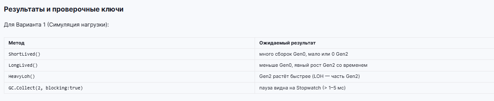
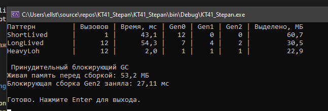

# КТ №41 - Параллельная и фоновая сборка мусора (Вариант 1)

Сделал вариант с симуляцией нагрузки. Реализовал три метода, которые по-разному нагружают память: `ShortLived` (много мелких объектов), `LongLived` (средние объекты, которые удерживаются в списке) и `HeavyLoh` (большие объекты, попадающие в LOH).

Для каждого метода с помощью `Stopwatch` замерил время выполнения, а через `GC.CollectionCount` посчитал, сколько сборок Gen0, Gen1 и Gen2 произошло. Отдельным столбцом вывожу объём аллокаций через `GC.GetAllocatedBytesForCurrentThread()` - так видно разницу между "сколько выделено" и "сколько осталось жить". В конце отдельно замерил паузу принудительной блокирующей сборки через `GC.Collect`.

## Почему сначала Gen1 и Gen2 были по нулям

В первой версии таблица выглядела так: `ShortLived 12/0/0`, `LongLived 1/0/0`, `HeavyLoh 0/0/0`, а пауза принудительной сборки была `0 мс`. Разобрался, в чём дело:

1. **Объекты не выживали.** В `LongLived` и `HeavyLoh` список создавался внутри метода. После выхода из метода ссылка пропадала, и все массивы сразу становились мусором. `GC.KeepAlive(list)` здесь не помогает: он гарантирует только то, что объект жив до конца метода, а не после возврата. Без выживших объектов нет продвижения в Gen1 и Gen2 - там просто нечему накапливаться.
2. **Объём был слишком маленький.** 5 000 массивов по 512 байт - это ~2,7 МБ, 20 массивов по 100 КБ - ~2 МБ. Бюджет Gen0 на моей машине около 7 МБ, поэтому `LongLived` вообще не вызывал сборок (1 сборка в отчёте - случайная), а 2 МБ в LOH не исчерпывали бюджет LOH.
3. **Пауза печаталась целыми миллисекундами** (`ElapsedMilliseconds`), а собирать было почти нечего, поэтому получался честный, но бесполезный `0 мс`.

## Что исправил

1. Списки вынес в статические поля `Workloads.KeptAlive` и `Workloads.LohKept`. Теперь объекты живут всё время работы программы, переживают сборки и продвигаются в Gen1 и Gen2.
2. Каждый сценарий повторяю несколько раз (`ShortLived` - 1, `LongLived` - 12, `HeavyLoh` - 12 вызовов), чтобы накопился объём. Это принципиально: сборка Gen2 начинается только после того, как исчерпан бюджет Gen2, а на моей машине для мелких объектов это примерно 30 МБ живых данных.
3. Добавил столбец "Выделено, МБ" - `GC.GetAllocatedBytesForCurrentThread()`. Он показывает, сколько памяти было выделено за шаг, независимо от того, что потом собралось.
4. Паузу печатаю через `TotalMilliseconds:F2`, чтобы были видны доли миллисекунды.

Задание:

Проверочные ключи:

Результат работы (вывод в консоль):

