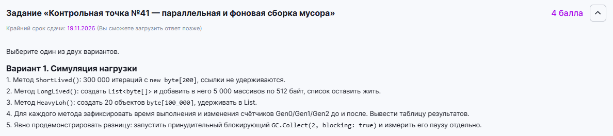
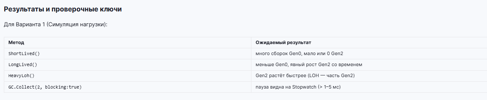
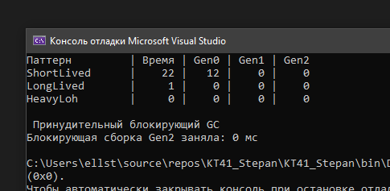

# КТ №41 - Параллельная и фоновая сборка мусора (Вариант 1)

Сделал вариант с симуляцией нагрузки. Реализовал три метода, которые по-разному нагружают память: `ShortLived` (много мелких объектов), `LongLived` (средние объекты, которые удерживаются в списке) и `HeavyLoh` (большие объекты, попадающие в LOH). 

Для каждого метода с помощью `Stopwatch` замерил время выполнения, а через `GC.CollectionCount` посчитал, сколько сборок Gen0, Gen1 и Gen2 произошло. В конце отдельно замерил паузу принудительной блокирующей сборки через `GC.Collect`.

Задание:

Проверочные ключи:

Результат работы (вывод в консоль):
